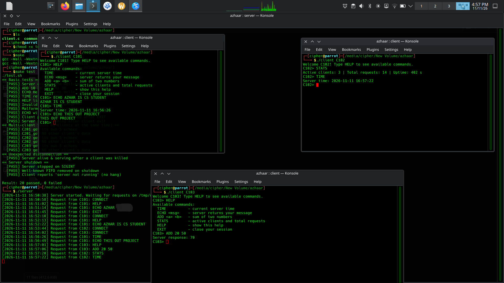

# Client–Server Communication Using Named Pipes (FIFOs)

Operating Systems semester project. A C client–server application on Linux
where multiple clients talk to one server using named pipes.

## Files

| File | Purpose |
|------|---------|
| `common.h` | Shared constants, `Request` / `Response` structs, `read_full()` helper |
| `server.c` | Server process |
| `client.c` | Client process |
| `Makefile` | Build, test and clean targets |
| `test.sh`  | Automated tests for the testing checklist |

## Problem Statement

Build a client-server application on Linux where **multiple clients** communicate with **one server** using **named pipes (FIFOs)** only. The system must be reliable: no mixed-up messages, no hanging, and no leftover files.

### Challenges

| # | Problem | Why it matters |
|---|---------|----------------|
| 1 | Many clients write to the same server FIFO at the same time | Messages from different clients could get mixed together |
| 2 | Server must reply to the correct client only | One shared reply pipe would mix up responses |
| 3 | A FIFO `read()` returns EOF when the last writer closes | Server would stop whenever all clients leave |
| 4 | `open()` on a FIFO blocks if the other side is missing | Client hangs if server is down; server hangs if a client died |
| 5 | A client can crash or be killed (`kill -9`) | Server must not freeze or crash |
| 6 | Server may never reply | Client would wait forever |
| 7 | FIFOs stay in `/tmp` after exit | Stale files break the next run |

## Solution

| # | Problem | Solution |
|---|---------|----------|
| 1 | Mixed requests | Fixed-size `Request` struct sent in **one `write()`**, smaller than `PIPE_BUF` (4096 bytes). POSIX guarantees such writes are atomic. |
| 2 | Wrong client gets reply | **Private FIFO per client** (`/tmp/os_<id>_fifo`). The request carries the path, and the server replies only there. |
| 3 | Server gets EOF | Server keeps a **dummy writer** open on its own FIFO, so `read()` keeps blocking instead of returning 0. |
| 4 | Blocking `open()` | `O_NONBLOCK` on both sides: the client gets "server not running" (`ENXIO`), and the server detects a dead client and removes it. |
| 5 | Client crash | Server handles `ENXIO` / write errors, drops that client, and keeps serving the others. `SIGPIPE` is ignored. |
| 6 | Client waits forever | Client uses `poll()` with a **5 second timeout**. |
| 7 | Leftover FIFOs | `SIGINT` / `SIGTERM` handled with `sigaction()`. Both programs `unlink()` their FIFOs on exit. The server also checks that a reply path is a real FIFO in `/tmp`. |

### Result

* Server handles multiple clients (tested with 3 at once) without mixing data.
* Server survives a client being killed and shuts down cleanly with Ctrl+C.
* Client never hangs: it reports "server not running" or a timeout.
* All 20 automated checks in `test.sh` pass (see screenshots below).

## Compile

```bash
make            # builds ./server and ./client
```

## Run

Open one terminal for the server and at least three for clients:

```bash
# Terminal 1
./server

# Terminals 2, 3, 4 ...
./client C101
./client C102
./client C103
```

Stop the server with `Ctrl+C` (it removes its FIFO and exits cleanly).

## Supported commands

| Command | Description |
|---------|-------------|
| `TIME` | Returns the current server time |
| `ECHO <message>` | Returns the message |
| `ADD <a> <b>` | Returns the sum of two numbers |
| `HELP` | Lists the commands |
| `EXIT` | Closes the client session (server keeps running) |
| `STATS` | *(extra)* Active clients, total requests, server uptime |

Commands are case-insensitive. Invalid commands and malformed input return an
error message.

## Run the automated tests

```bash
chmod +x test.sh
make test       # or: bash test.sh
```

## Design summary

* **Well-known FIFO:** `/tmp/os_server_fifo` – all clients write requests here.
* **Private FIFO per client:** `/tmp/os_<id>_fifo` – the server writes that client's responses here, so responses are never mixed up.
* **Request format:** fixed-size C struct `{client_id, fifo_path, command, args}` (see `common.h`). Logical form: `C101|/tmp/os_C101_fifo|ADD|10 20`.
* **Concurrency safety:** each request/response is one `write()` smaller than `PIPE_BUF` (4096 bytes), which POSIX guarantees to be atomic – requests from different clients can't interleave.
* **No hanging:**
  * Server keeps a dummy writer open on its own FIFO so `read()` doesn't return EOF when the last client leaves.
  * Server opens client FIFOs with `O_NONBLOCK`; a dead client gives `ENXIO` and is simply removed.
  * Client opens the server FIFO with `O_NONBLOCK`, so it prints "server not running" instead of blocking.
  * Client waits for replies with `poll()` and a 5 s timeout.
* **Cleanup:** `SIGINT`/`SIGTERM` handled with `sigaction()`; `unlink()` removes FIFOs on exit. `SIGPIPE` is ignored.
* **Extras implemented:** `STATS` command, server activity log (`os_server.log`), client timeout, active-client tracking.

## Assumptions and limitations

* Linux only (uses `mkfifo`, `poll`, `sigaction`).
* The server is single-process and handles requests one by one (simple and safe; no `fork()`).
* Client IDs must be unique, using letters, digits and `_` only. If a client is killed with `kill -9`, remove its leftover FIFO: `rm /tmp/os_<id>_fifo`.
* Maximum 64 clients are tracked at once.

## Screenshots

### Server with three clients running


### Server terminal: automated tests (20 passed) and live request log

